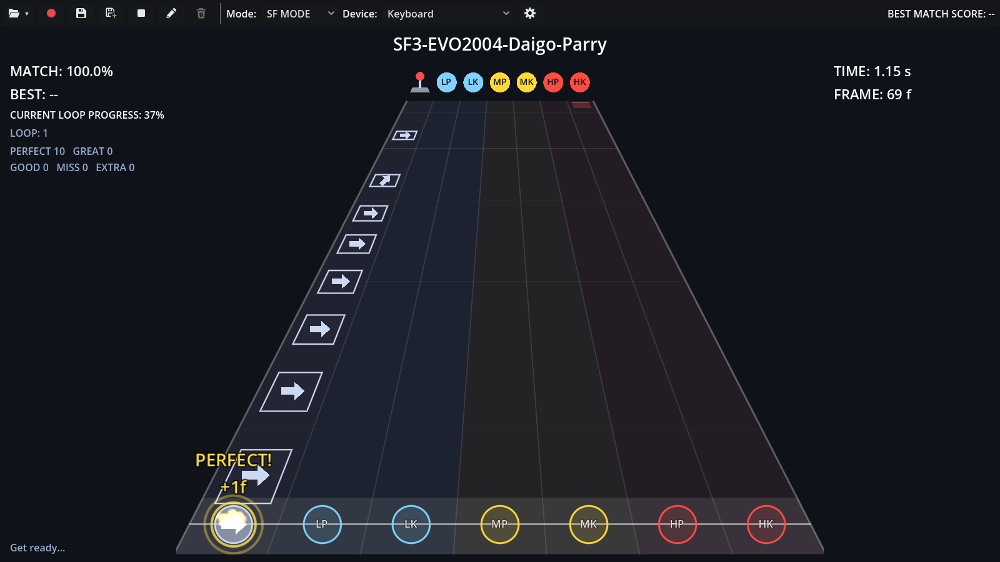
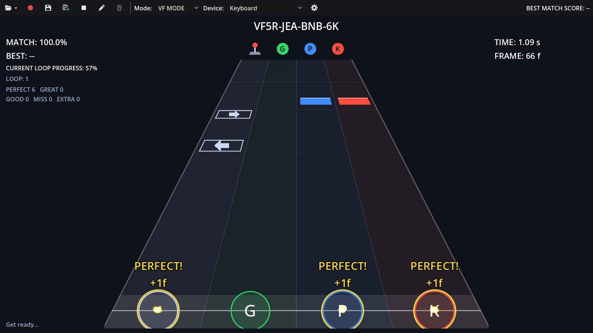
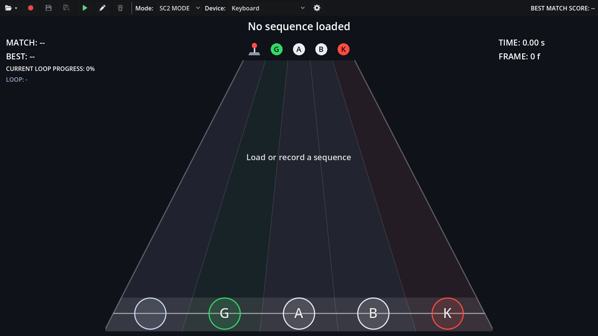
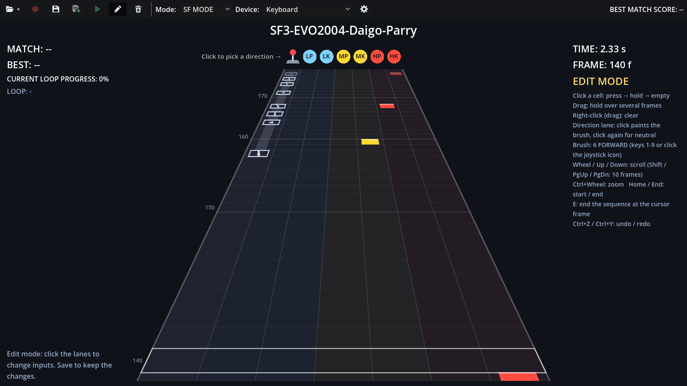
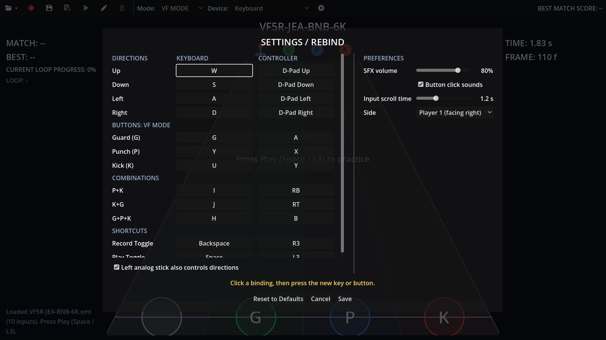

# Input Trainer

A rhythm-game style trainer for practicing fighting game execution, with input modes for **Virtua Fighter**, **Soul Calibur 2** and classic 6-button **Street Fighter**.

Record a combo (or load one), then play it back Guitar Hero style: your inputs scroll down a highway and you press them in time. Every press is judged to the frame, so you can see exactly how early or late you are and drill until it's consistent.

Built with **Godot 4.7**.



---

## Features

- **Three input modes.** VF (G, P, K), SC2 (G, A, B, K) and SF (LP, LK, MP, MK, HP, HK), each with its own lanes, colors and bindings.
- **Frame-by-frame editor.** Fix a recording or write a sequence from scratch, one frame at a time, right on the highway.
- **Combination buttons.** Bind one button to several at once, like P+K in VF or HP+HK in SF.
- **Record your own sequences.** Recording starts on your first press, so there's no dead time at the start. Diagonals, simultaneous buttons (like P+G) and held inputs are all captured.
- **Frame-accurate judging.** Each input is rated **PERFECT**, **GREAT**, **GOOD** or **MISS**, and shows how many frames early or late you were (`-2f`, `+1f`).
- **Hold inputs.** Directions or buttons held for 15+ frames become hold inputs, and you must keep them held to the end.
- **Endless practice loop.** The sequence repeats automatically, with a match score for each loop and your best score shown at all times.
- **Keyboard or controller.** Works with gamepads, arcade sticks and fightpads. Pick your device from a dropdown, and your choice is remembered.
- **Full rebinding.** Change every key and button, including the record and play shortcuts.
- **Player 1 / Player 2 side.** Forward and back follow the side you choose, just like in the game.
- **Shareable XML files.** Sequences are plain, readable XML files you can save, edit and swap with friends.

---

## Getting started

### Download the application

1. Download the latest version from [Releases](https://github.com/ventenpoulpe/input-trainer/releases).
2. Unzip the archive you've downloaded to the folder of your choice.
   Avoid `C:\Program Files`, since the app saves your recordings next to the `.exe`.
3. Make sure to leave the **Sequences/** folder in the same folder as the exe file.

Requires Windows 10 or 11 and a reasonably recent graphics driver (the app uses Direct3D 12).

> [!WARNING]
> **"Windows protected your PC"**
> The executable isn't code-signed, so Windows SmartScreen may block it the first time you run it.
> To start it anyway, click **More info**, then **Run anyway**. You only need to do this once.

### Your first practice session

1. Check that **Mode** in the toolbar is set to **VF MODE** (the default), then click the **Load** button (, first in the toolbar), open the `VF5R` folder and pick the included sample `VF5R-JEA-BNB-6K`.
2. Press **Space** (keyboard) or **L3** (controller) to start.
3. After a short countdown, hit each input as it crosses the line at the bottom of the track.
4. Press **Space** / **L3** again to stop.

### Included sequences

| File | Mode | What it is |
|---|---|---|
| `VF5R/VF5R-JEA-BNB-6K` | VF | A Jean Kujo bread-and-butter combo starting with 6K (Virtua Fighter 5 R.E.V.O.) |
| `SF3/SF3-EVO2004-Daigo-Parry` | SF | Daigo's famous EVO 2004 parry of Chun-Li's super, then his punish combo into Shippu Jinrai-kyaku. The timing is reconstructed by hand, so it's close but not frame data from the match. |

Switch **Mode** to **SF MODE** before loading the Daigo sequence.

---

## How to use it

### The toolbar

The toolbar buttons are icons. Hover over one to see what it does and its shortcut.

| Icon | Button | What it does |
|---|---|---|
|  | **Load** | Opens the list of sequences in the `Sequences` folder, plus **Browse...** and **Open Sequences folder** |
|  | **Record** | Arms a recording (**Backspace** / **R3**). While armed it shows  to cancel, and  to stop once recording |
|  | **Save** | Saves the changes to the current file |
|  | **Save as** | Saves to a new file in the `Sequences` folder |
|  | **Play** | Starts practicing (**Space** / **L3**). Shows  while playing: click it to stop |
|  | **Edit** | Turns frame-by-frame edit mode on or off |
|  | **Clear** | In edit mode: removes every input of the sequence (**Ctrl+Z** brings them back) |
|  | **Settings** | Rebinding, sound and gameplay settings |

The **Mode** and **Device** dropdowns sit between **Clear** and **Settings**, and your best score is on the right.

### Choosing an input mode

Pick your game in the **Mode** dropdown in the toolbar. The highway and the buttons you use change right away, and your choice is remembered.

| Mode | Game | Buttons |
|---|---|---|
| **VF MODE** | Virtua Fighter | **G** Guard, **P** Punch, **K** Kick |
| **SC2 MODE** | Soul Calibur 2 | **G** Guard, **A** Horizontal, **B** Vertical, **K** Kick |
| **SF MODE** | Street Fighter (classic) | **LP**, **LK**, **MP**, **MK**, **HP**, **HK** |

| VF MODE | SC2 MODE | SF MODE |
|---|---|---|
|  |  |  |

Each sequence file remembers the mode it was recorded in. If you load a sequence made for another mode, an orange warning appears under the timers on the right, and the sequence can't be played until you either switch to the matching mode or load a sequence for the current one.

### Recording a sequence

1. Press **Backspace** (keyboard) or **R3** (controller), or click **Record** ().
   The screen shows **ARMED**: nothing is recorded yet.
2. Perform your sequence. **Your first press is time zero.** The recording uses the current mode.
3. Press **Backspace** / **R3** again to stop.
4. Click **Save as** (), give it a name, and it's saved to the `Sequences` folder.
   After that, **Save** () overwrites the same file.

> Tip: pressing record while it's still armed cancels it.

### Editing a sequence frame by frame

Click the **Edit** button () in the toolbar to enter edit mode (click it again to leave). It edits the current sequence, or starts a new empty one if none is loaded. The highway then shows one row per frame (60 per second), and the row on the hit line is the **cursor**.



| To do this | Do this |
|---|---|
| Press a button on a frame | Click its cell: empty → pressed → held → empty |
| Hold a button over several frames | Click the first frame and drag |
| Set the direction on a frame | Click the direction lane (paints the **brush**); drag for several frames |
| Pick the direction brush | Keys **1–9** (numpad notation: 6 = forward, 2 = down, 3 = down-forward…), or click the joystick at the top of the track |
| Clear cells | Right-click (and drag) |
| Scroll | Mouse wheel or **Up / Down** (**Shift** or **Page Up / Down** for 10 frames) |
| Zoom | **Ctrl + mouse wheel** |
| Jump to the start / end | **Home** / **End** |
| End the sequence at the cursor | **E** |
| Clear every input | **Clear** button () |
| Undo / redo | **Ctrl+Z** / **Ctrl+Y** |

- Presses and holds shorter than 15 frames are saved as plain taps, and they're drawn dimmer as a reminder.
- Changes apply right away (a `*` appears after the file name). Click **Save** () to keep them.
- **Record** and **Play** are off while editing: leave edit mode to play your changes.

### Playing a sequence

Press **Space** / **L3** or click **Play** (). A 1-second countdown appears, then inputs start falling. When a loop ends you get your score, a short 0.5 s pause, and the next loop starts.

### Reading the screen


The first lane is always the **direction** lane: press the direction shown by the arrow. The other lanes are your mode's buttons, from left to right:

| Mode | Lanes and colors |
|---|---|
| VF | **G** green, **P** blue, **K** red |
| SC2 | **G** green, **A** white, **B** white, **K** red |
| SF | **LP**, **LK** light blue, **MP**, **MK** yellow, **HP**, **HK** red |

- **Long bars** behind an input are **holds**: keep the input down until the bar ends.
- The circles on the hit line light up with what you're currently holding, which is handy for checking your inputs. A combination button lights up all of its buttons.
- The title at the top shows the loaded file's name (with a `*` when there are unsaved changes).
- **TIME** and **FRAME** (60 FPS) on the right show where you are in the sequence.

### Scoring

| Rating | Timing | Points |
|---|---|---|
| PERFECT! | within ±2 frames | 100% |
| GREAT | within ±4 frames | 75% |
| GOOD | within ±6 frames | 50% |
| MISS | outside ±6 frames | 0% |

- A completed hold gives an extra point (**HOLD OK**). Letting go too early gives a **DROP**.
- Pressing a button when nothing is there counts as **EXTRA** and lowers your score, so mashing doesn't pay.
- Extra direction movements are **not** penalized, since moving between directions naturally passes through others.

Your **best score** resets when you load or record a different sequence.

---

## Controls

All bindings can be changed in **Settings** ().

**All modes**

| Action | Keyboard | Controller |
|---|---|---|
| Up | W | D-Pad Up / Left Stick |
| Down | S | D-Pad Down / Left Stick |
| Left | A | D-Pad Left / Left Stick |
| Right | D | D-Pad Right / Left Stick |
| Record start/stop | Backspace | R3 (Right Stick Click) |
| Play start/stop | Space | L3 (Left Stick Click) |

**VF MODE**

| Action | Keyboard | Controller |
|---|---|---|
| Guard (G) | G | A |
| Punch (P) | Y | X |
| Kick (K) | U | Y |
| P+K | I | RB |
| K+G | J | RT |
| G+P+K | H | B |

**SC2 MODE**

| Action | Keyboard | Controller |
|---|---|---|
| Guard (G) | G | A |
| Horizontal (A) | Y | X |
| Vertical (B) | U | Y |
| Kick (K) | H | B |
| A+B | I | RB |
| A+G | T | LB |
| B+K | J | RT |
| G+B | K | LT |

**SF MODE**

| Action | Keyboard | Controller |
|---|---|---|
| Light Punch (LP) | Y | X |
| Light Kick (LK) | H | A |
| Medium Punch (MP) | U | Y |
| Medium Kick (MK) | J | B |
| Heavy Punch (HP) | I | RB |
| Heavy Kick (HK) | K | RT |
| MP+MK | G | LB |
| HP+HK | L | LT |

Controller buttons use Xbox names (A = bottom face button). The keyboard shortcuts for Record and Play always work, even when a controller is selected.

### Rebinding

1. Select the mode you want to change in the **Mode** dropdown, then open **Settings** ().
   The menu shows the directions, that mode's buttons and combinations, and the shortcuts.

   

2. Click a binding, then press the new key or button within 5 seconds (**Esc** cancels).
3. If that input was already used by another action in the same mode, the two swap. Different modes can use the same keys.
4. Click **Save** to keep your changes, **Cancel** to undo them, or **Reset** to restore the defaults (for every mode).

### Other settings

| Setting | What it does | Default |
|---|---|---|
| SFX volume | Volume of hit sounds and effects | 80% |
| Button click sounds | Click sound on menu buttons | On |
| Input scroll time | How long inputs take to reach the hit line (lower = faster) | 1.2 s |
| Side | Player 1 (facing right) or Player 2 (facing left) | Player 1 |

Settings are saved in `settings.cfg`, next to the executable (like the `Sequences` folder). Settings from older versions, kept in Godot's user data folder, are imported on first launch.

---

## Sequence files

Sequences are stored in the `Sequences` folder:

- When running from the Godot editor: `Sequences/` inside the project.
- In an exported build: a `Sequences` folder next to the executable.

The **Load** menu () lists every file in that folder, and also has **Browse...** and **Open Sequences folder**.

You can organize the folder with subfolders, as deep as you like (for example `VF5R/`, `SC2/`, `SF/SF3/`, `SF/SF6/`). Each subfolder shows up as a submenu in the **Load** menu, folders first, then files. Empty folders, and folders whose name starts with a dot, are hidden. **Save as** always saves to the top of the `Sequences` folder; move the file into a subfolder afterwards if you want.

### File format

```xml
<?xml version="1.0" encoding="utf-8"?>
<InputSequence name="Jean_Kujo_BnB01" author="Player1" mode="VF" duration="4.500">
    <Input timestamp="0.000" frame="0">
        <Direction>FORWARD</Direction>
        <Buttons></Buttons>
    </Input>
    <Input timestamp="0.300" frame="18">
        <Direction hold="0.400" holdFrames="24">DOWN_FORWARD</Direction>
        <Buttons>
            <Button hold="0.300" holdFrames="18">G</Button>
            <Button>P</Button>
        </Buttons>
    </Input>
</InputSequence>
```

- **mode**: `VF`, `SC2` or `SF`. Files without it are read as VF.
- **timestamp**: seconds from the first press. **frame**: the same time at 60 FPS.
- **Direction**: what's held at that moment, in VF notation relative to facing:
  `NEUTRAL`, `UP`, `DOWN`, `FORWARD`, `BACK`, `UP_FORWARD`, `UP_BACK`, `DOWN_FORWARD`, `DOWN_BACK`.
- **Buttons**: the buttons newly pressed at that moment, using the mode's button names (VF: `G`, `P`, `K`; SC2: `G`, `A`, `B`, `K`; SF: `LP`, `LK`, `MP`, `MK`, `HP`, `HK`). A combination is saved as its separate buttons.
- **hold** (optional): how long the input is held, in seconds.

Files using the older `<InputNote>` tag still load.

---

## Project structure

```
autoload/      Global services: settings, input bindings, sequence manager, sound effects
gameplay/      Practice loop and timing judge (ratings and scoring)
sequence/      Input modes, sequence data, recorder, frame editor and XML reader/writer
ui/            Highway, countdown, mode and device selectors, save dialog, settings menu
Sequences/     Sequence XML files
docs/          README screenshots
tools/         Screenshot capture scene that retakes the README screenshots
main.tscn      Main screen
export_presets.cfg  Godot export settings
specs.md       Full technical and functional specification
```

See [specs.md](specs.md) for the full specification.

To retake the README screenshots after a UI change, run from the project folder:

```
Godot.exe --path . --resolution 1600x900 res://tools/capture_screenshots.tscn
```

It sets up each shot (a bot plays the sequences, so every hit is PERFECT), saves the PNGs to `docs/screenshots/`, and puts your input mode and device back afterwards.
